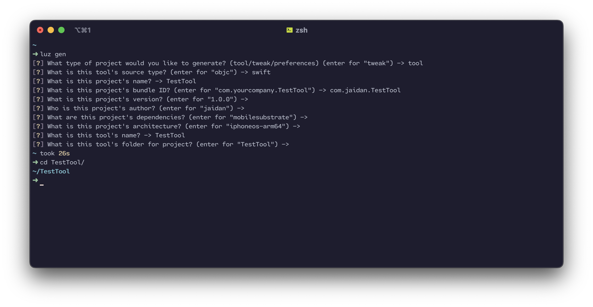

Generation
---------------------

Luz comes with a built-in project generator called ``LuzGen``. It can be used to create a new project with the following command:

.. code:: bash

    $ luz gen

This command will walk you through the steps to create a new project. It can
generate tools, tweaks, preferences bundles, libraries, and frameworks. The
library and framework generators currently provide Objective-C and Swift
starter sources. Framework projects include a Resources directory and, for an
Objective-C source, an exported public header. When packaged, Luz creates a
flat ``Name.framework`` bundle: the binary and ``Info.plist`` are at its root,
public headers are in ``Headers/``, and all other project resources are in
``Resources/``. Finally, you enter project metadata such as the name, author,
and version.

