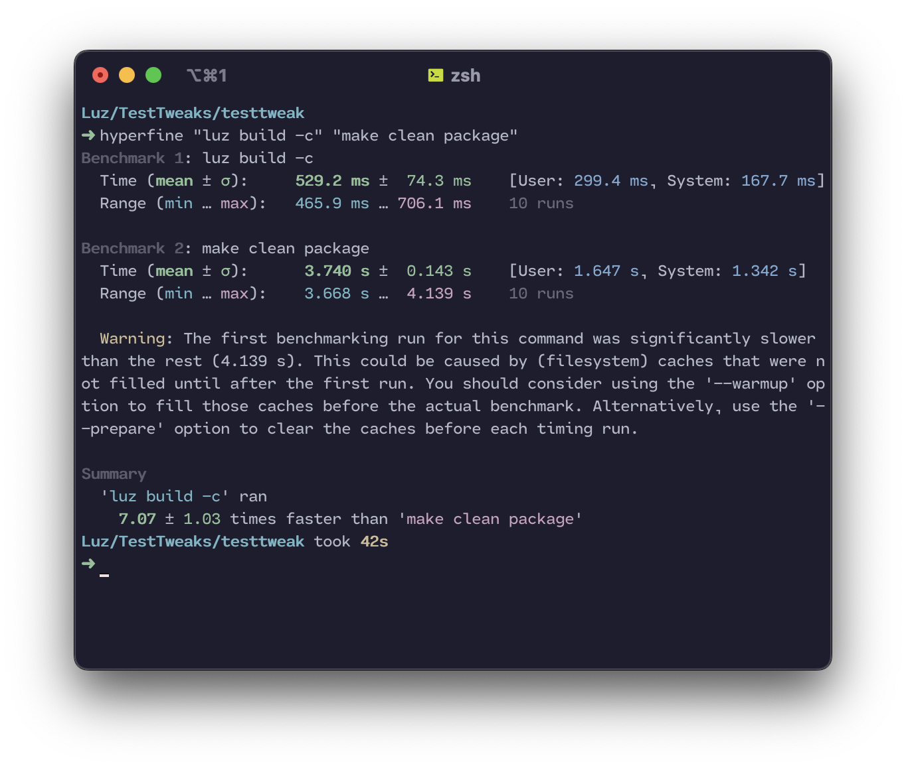

.. Luz documentation master file, created by
   sphinx-quickstart on Wed Feb 15 23:05:07 2023.
   You can adapt this file completely to your liking, but it should at least
   contain the root `toctree` directive.

.. Mastodon
.. raw:: html

   <a hidden rel="me" href="https://procursus.social/@luz">Mastodon</a>

Luz
===============================

Luz is a build system for Apple Darwin-based systems. It's name is derived from the Spanish word for "light." It's meant to be a lightweight, drop in replacement for other build systems such as Dragon and Theos.

Benifits over "theos" and "dragon"
----------------------------------

Note: Luz is a work-in-progress project. Features will change, and bugs will be fixed. If you find a bug, please report it on the GitHub repository.

Speed
*****************************

Luz is written in Python and uses the native Python pyLogos interpreter for
Logos sources. It caches unchanged source objects and builds changed source /
architecture pairs in parallel. Luz also builds independent submodules in
parallel, so a project is not forced to wait for each unrelated submodule in
sequence.

Below you can find a benchmark of Luz vs. Theos, using the time comparison tool `hyperfine`. The same tweak was built (clean) with both build systems.

.. note::

   This benchmark was ran on a 2020 MacBook Pro with an M1 processor, 8 GB of RAM, and a 256 GB SSD.

As you can see, Luz is much faster than Theos, and is able to build the same project in less than half the time.

Source Code Structure
*****************************
Each of Luz's modules have a different source file, which are all subclassed from a main class called `Module`. This allows for easy extensibility, and allows for the creation of new modules without having to modify the core of the build system.

.. toctree::
   :maxdepth: 2
   :caption: Contents:

   setup
   commands
   generation
   format
